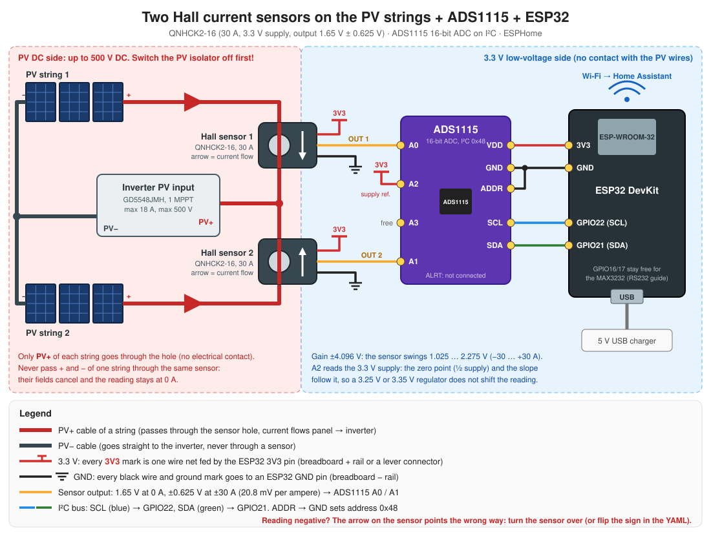

# Build guide: PV string current with Hall sensors + ADS1115 on the ESP32

This guide adds two Hall-effect current sensors to the ESP32 from [esphome-hardware.md](esphome-hardware.md), one on each PV string, so Home Assistant shows the current of every string in real time. The PV+ cable of each string passes through the hole of a **QNHCK2-16** sensor (30 A, 3.3 V supply); there is no electrical contact with the PV circuit. The sensors give an analog voltage, which an **ADS1115** 16-bit ADC converts and sends to the ESP32 over I²C. The firmware is the ESPHome package [`esphome/packages/pv-string-current.yaml`](../esphome/packages/pv-string-current.yaml), which can be added to either ESP32 config. It only reads the sensors and never talks to the inverter. The hardware has **not yet been built or tested**; the package passes `esphome config` (ESPHome 2026.9.1) but has not been compiled.



## 1. How it works

```text
 PV string 1 PV+ --(through hole)--> Hall sensor 1 --OUT 1--> ADS1115 A0 \
 PV string 2 PV+ --(through hole)--> Hall sensor 2 --OUT 2--> ADS1115 A1  > I2C --> ESP32 --Wi-Fi--> Home Assistant
                       ESP32 3V3 (sensor supply) -----------> ADS1115 A2 /         (ESPHome API)
```

- The sensor measures the magnetic field of the current in the cable. At 0 A its output is half the supply (1.65 V at 3.3 V); every ampere adds 0.625 V / 30 A = **20.8 mV** (current in the arrow direction) or subtracts it (opposite direction). Range: 1.025 V at −30 A … 2.275 V at +30 A.
- **Why an ADS1115** and not the ESP32's own ADC: the ESP32 ADC is non-linear and noisy, and an error of 0.1 V is already about 5 A here. The ADS1115 has 16 bits; with gain ±4.096 V one step is 0.125 mV ≈ 0.006 A, so the sensor itself, not the ADC, limits the accuracy.
- **Why A2 reads 3.3 V:** the sensor output follows its supply (the zero point is half the supply). An ESP32 regulator giving 3.25 V instead of 3.30 V would shift the zero by 25 mV ≈ 1.2 A. The firmware measures the supply on A2 and computes `I = (OUT − supply/2) / (0.0208 V/A × supply/3.3 V)`, so this error cancels. This assumes a ratiometric sensor (1.65 V = 3.3 V / 2 suggests it); the zero calibration in step 6 removes what is left either way.
- The inverter has one MPPT input (max 18 A). With two strings in parallel the inverter only sees the sum; the sensors show each string separately, so a shaded, dirty or failing string becomes visible.

## 2. Parts list

| # | Part | Notes |
|---|---|---|
| 1 | **2 × Hall current sensor QNHCK2-16**, 30 A, supply 3.3 V, output 1.65 V ± 0.625 V | Through-hole (open-loop) DC sensor. Check that the PV cable (4–6 mm², about 5–7 mm outer diameter) fits through the hole. Must be the **3.3 V** variant: a 5 V one outputs 2.5 V ± … and needs other values in the YAML |
| 2 | **ADS1115 module** (blue or purple board, 10 pins) | 16-bit, 4 inputs, I²C. Powered from 3.3 V, so no input can get above 3.3 V |
| 3 | The ESP32 DevKit from the [RS232 guide](esphome-hardware.md#2-parts-list) | Or any ESP32: the sensors do not need the MAX3232 |
| 4 | Jumper wires, breadboard or 2 lever connectors (5-way) | One "3V3" and one "GND" distribution point: 3V3 and GND each go to 4 places |
| 5 | 3-wire cable from each sensor to the ESP32 box | Keep it short (≤ 1–2 m) and away from the inverter's AC wires; twisted or shielded is better |

## 3. Wiring

Do this with the ESP32 unplugged and **the PV isolator (DC switch) off**: the PV cables carry up to 500 V DC.

### Sensors on the PV cables

1. Open the PV+ cable of string 1 at a connector (MC4) **before** the point where both strings are joined, thread it through the hole of sensor 1, and close it again. Same for string 2 and sensor 2.
2. The arrow on the sensor points in the current direction: **from the panels to the inverter**. A reversed sensor gives a negative current (turn it over, or change the sign in the YAML).
3. Only PV+ goes through the hole. PV+ and PV− of the same string through one sensor cancel each other (reading 0 A). PV− goes straight to the inverter.
4. Fix the sensor so it does not hang on the cable, and keep the insulation intact: the sensor isolates only through the cable's own insulation.

### Low-voltage wiring

| From | To | Wire colour in the figure |
|---|---|---|
| ESP32 **3V3** | ADS1115 **VDD**, ADS1115 **A2**, sensor 1 **+3.3 V**, sensor 2 **+3.3 V** | red |
| ESP32 **GND** | ADS1115 **GND**, ADS1115 **ADDR** (address 0x48), sensor 1 **GND**, sensor 2 **GND** | black |
| Sensor 1 **OUT** | ADS1115 **A0** | yellow |
| Sensor 2 **OUT** | ADS1115 **A1** | yellow |
| ADS1115 **SCL** | ESP32 **GPIO22** | blue |
| ADS1115 **SDA** | ESP32 **GPIO21** | green |
| ADS1115 **ALRT**, **A3** | not connected | |

The ADS1115 module's header is usually printed `VDD GND SCL SDA ADDR ALRT A0 A1 A2 A3`; the figure groups the pins by function instead. Sensor wire colours differ between sellers (often red = +, black = −, yellow/white = OUT): check the label. GPIO21/22 do not clash with GPIO16/17 used by the MAX3232, so one ESP32 can do both. Power everything from **3V3**, never 5 V/VIN: a 5 V supply would push the sensor's output and the ADS1115 above what the ESP32 side expects.

### Check before power-on

```text
[ ] only PV+ passes through each sensor, arrow towards the inverter
[ ] no metal part of the sensor touches a PV conductor
[ ] sensors, ADS1115 VDD and A2 are on 3V3 (not 5V / VIN)
[ ] all GND wires go to ESP32 GND; ADDR is on GND
[ ] OUT 1 -> A0, OUT 2 -> A1
```

## 4. Firmware

Add the package to the ESP32 config you already use, by uncommenting its lines (copy `packages/pv-string-current.yaml` along when you use the ESPHome Dashboard):

```yaml
packages:
  pv_current: !include packages/pv-string-current.yaml
```

- **Bridge config** ([`vevor-bridge.yaml`](../esphome/vevor-bridge.yaml)): the HACS integration still reads the inverter through TCP port 8899, and the current sensors appear in Home Assistant through the ESPHome integration on the same ESP32.
- **Native config** ([`vevor-inverter.yaml`](../esphome/vevor-inverter.yaml)): the package line is next to the controls package.
- **ESP32 without the inverter link** (the Elfin gateway stays): any ESPHome config with `wifi`, `api` and `ota` plus this package.

Settings at the top of the package (`substitutions`, override them in the main file if needed):

| Substitution | Default | Meaning |
|---|---|---|
| `i2c_sda_pin`, `i2c_scl_pin` | `GPIO21`, `GPIO22` | I²C pins |
| `hall_sensitivity` | `0.0208333` | V per ampere at 3.3 V supply (0.625 V / 30 A) |
| `string1_zero_trim`, `string2_zero_trim` | `0.0` | zero calibration in amperes (step 6) |

## 5. Entities in Home Assistant

The entities belong to the ESP32's ESPHome device (not to the Voltronic integration's device). They follow the owner's naming convention: `… raw` = every sample (for the live view; exclude `*_raw` from the recorder), plain name = smoothed.

| Entity | Unit | Update | Source |
|---|---|---|---|
| PV string 1 current raw | A | every 1 s (mean of 4 readings at 250 ms) | A0 |
| PV string 2 current raw | A | every 1 s | A1 |
| PV string 1 current | A | 60 s mean, every 60 s | copy of the raw sensor |
| PV string 2 current | A | 60 s mean, every 60 s | copy of the raw sensor |
| Hall sensor supply (diagnostic) | V | every 1 s (5-sample mean) | A2 |

### Combining with the integration's data

Both strings share the inverter's single MPPT input, so they have the same voltage: the integration's *PV voltage* gives the power of each string. Template sensors in Home Assistant (adapt the entity IDs to yours):

```yaml
template:
  - sensor:
      - name: PV string 1 power
        unit_of_measurement: W
        device_class: power
        state_class: measurement
        state: >
          {{ (states('sensor.pv_string_1_current') | float(0)
              * states('sensor.vevor_inverter_pv_voltage') | float(0)) | round(0) }}
      - name: PV strings total current
        unit_of_measurement: A
        device_class: current
        state_class: measurement
        state: >
          {{ (states('sensor.pv_string_1_current') | float(0)
              + states('sensor.pv_string_2_current') | float(0)) | round(1) }}
```

The total can be compared with the integration's *PV current* (`QPIGS[12]`) and *PV power full*: a real measurement on the PV cables answers the open question of how much PV power the inverter does not report (see [project-overview.md](project-overview.md), roadmap item 8/11).

## 6. First test and zero calibration

1. Power the ESP32 with the PV isolator **off**. In the log (`esphome logs …`) the ADS1115 is found at `0x48`; *Hall sensor supply* reads about 3.3 V.
2. With PV off, both *raw* currents should be close to 0 A (typically within ±0.3 A). Note the mean of a few minutes, then set `string1_zero_trim` / `string2_zero_trim` to **minus** that value (reading +0.25 A → `-0.25`) and flash again.
3. Switch PV on in daylight. Both strings should read a positive current of similar size; their sum should be close to the inverter's PV current and to a clamp meter on the common PV+ cable.
4. A negative value means the sensor is reversed: turn it over (PV off first).

## 7. Troubleshooting

| Symptom | Likely cause | Fix |
|---|---|---|
| Log: ADS1115 not found / I²C errors | SDA/SCL swapped, no 3V3/GND on the module, ADDR floating | Check the blue/green wires, VDD and ADDR → GND; the I²C scan in the log must show `0x48` |
| Current entities stay *unknown* | *Hall sensor supply* is missing or below 3.0 V (the formula is skipped on purpose) | Check the red wire to A2 and the 3V3 rail |
| Reading about −79 A | Sensor OUT not connected (A0/A1 floating near 0 V) | Check the yellow wire and the sensor supply |
| Constant ~0 A with PV producing | PV+ and PV− both through the sensor, or the wrong cable | Only PV+ of one string per sensor |
| Negative current | Sensor reversed | Turn it over, or change the sign of the formula |
| Zero drifts during the day | Temperature drift of an open-loop Hall sensor | Calibrate at the usual operating temperature; keep the sensors out of the sun and away from the inverter's heat sink |
| Noisy reading | Long sensor cable next to AC wires | Shorter or twisted/shielded cable; the 60 s smoothed entity is meant for history |

## 8. Safety notes

- The PV strings can carry up to 500 V DC and cannot be switched off at the panels while the sun shines. Open MC4 connectors only with the PV isolator off and no current flowing (opening under load draws an arc).
- The sensor must sit on intact cable insulation; never strip or cut the PV cable for it.
- The low-voltage side (sensors' wires, ADS1115, ESP32) must never touch a PV conductor.
