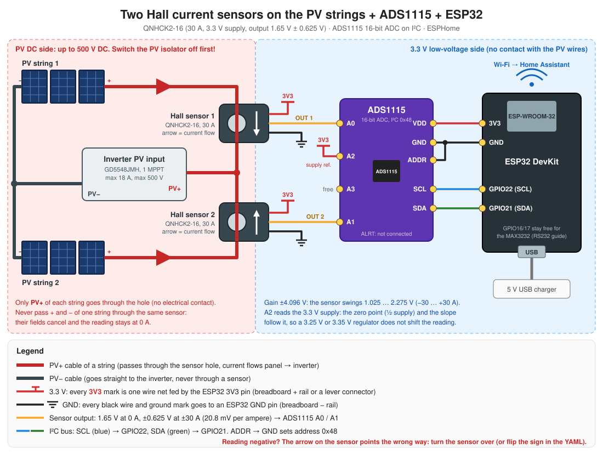

# Build guide: PV string current with Hall sensors + ADS1115 on the ESP32

This guide adds two Hall-effect current sensors to the ESP32 from [esphome-hardware.md](esphome-hardware.md), one on each PV string, so Home Assistant shows the current of every string in real time. The PV+ cable of each string passes through the hole of a **QNHCK2-16** sensor (30 A, 3.3 V supply); there is no electrical contact with the PV circuit. The sensors give an analog voltage, which an **ADS1115** 16-bit ADC converts and sends to the ESP32 over I²C. The firmware is the ESPHome package [`esphome/packages/pv-string-current.yaml`](../esphome/packages/pv-string-current.yaml), which can be added to either ESP32 config. It only reads the sensors and never talks to the inverter. A second opt-in package, [`pv-string-energy.yaml`](../esphome/packages/pv-string-energy.yaml), turns the currents plus the PV voltage passed from Home Assistant into PV power and energy (total, today, this month, with the last day / month), see [Power and energy on the ESP32](#power-and-energy-on-the-esp32-pv-string-energyyaml). The owner has built the hardware; with no cable in the holes the readings sit within about ±0.3 A of zero (normal offset of an open-loop sensor, removed by the zero trim in step 6). Not yet tested with PV current. The package passes `esphome config` (ESPHome 2026.10.2) but has not been compiled by the agent.



## 1. How it works

```text
 PV string 1 PV+ --(through hole)--> Hall sensor 1 --OUT 1--> ADS1115 A0 \
 PV string 2 PV+ --(through hole)--> Hall sensor 2 --OUT 2--> ADS1115 A1  > I2C --> ESP32 --Wi-Fi--> Home Assistant
                       ESP32 3V3 (sensor supply) -----------> ADS1115 A2 /         (ESPHome API)
```

- The sensor measures the magnetic field of the current in the cable. At 0 A its output is half the supply (1.65 V at 3.3 V); every ampere adds 0.625 V / 30 A = **20.8 mV** (current in the arrow direction) or subtracts it (opposite direction). Range: 1.025 V at −30 A … 2.275 V at +30 A.
- **Why an ADS1115** and not the ESP32's own ADC: the ESP32 ADC is non-linear and noisy, and an error of 0.1 V is already about 5 A here. The ADS1115 has 16 bits; with gain ±4.096 V one step is 0.125 mV ≈ 0.006 A, so the sensor itself, not the ADC, limits the accuracy.
- **Why A2 reads 3.3 V:** the sensor output follows its supply (the zero point is half the supply). An ESP32 regulator giving 3.25 V instead of 3.30 V would shift the zero by 25 mV ≈ 1.2 A. The firmware measures the supply on A2 and computes `I = (OUT − supply/2) / (0.0208 V/A × supply/3.3 V)`, so this error cancels. This assumes a ratiometric sensor (1.65 V = 3.3 V / 2 suggests it); the zero calibration in step 6 removes what is left either way.
- The inverter has one MPPT input (max 18 A). With two strings in parallel the inverter only sees the sum; the sensors show each string separately, so a shaded, dirty or failing string becomes visible.

## 2. Parts list

| # | Part | Notes |
|---|---|---|
| 1 | **2 × Hall current sensor QNHCK2-16**, 30 A, supply 3.3 V, output 1.65 V ± 0.625 V | Through-hole (open-loop) DC sensor. Check that the PV cable (4–6 mm², about 5–7 mm outer diameter) fits through the hole. Must be the **3.3 V** variant: a 5 V one outputs 2.5 V ± … and needs other values in the YAML |
| 2 | **ADS1115 module** (blue or purple board, 10 pins) | 16-bit, 4 inputs, I²C. Powered from 3.3 V, so no input can get above 3.3 V |
| 3 | The ESP32 DevKit from the [RS232 guide](esphome-hardware.md#2-parts-list) | Or any ESP32: the sensors do not need the MAX3232 |
| 4 | Jumper wires, breadboard or 2 lever connectors (5-way) | One "3V3" and one "GND" distribution point: 3V3 and GND each go to 4 places |
| 5 | 3-wire cable from each sensor to the ESP32 box | Keep it short (≤ 1–2 m) and away from the inverter's AC wires; twisted or shielded is better |

## 3. Wiring

Do this with the ESP32 unplugged and **the PV isolator (DC switch) off**: the PV cables carry up to 500 V DC.

### Sensors on the PV cables

1. Open the PV+ cable of string 1 at a connector (MC4) **before** the point where both strings are joined, thread it through the hole of sensor 1, and close it again. Same for string 2 and sensor 2.
2. The arrow on the sensor points in the current direction: **from the panels to the inverter**. A reversed sensor gives a negative current (turn it over, or change the sign in the YAML).
3. Only PV+ goes through the hole. PV+ and PV− of the same string through one sensor cancel each other (reading 0 A). PV− goes straight to the inverter.
4. Fix the sensor so it does not hang on the cable, and keep the insulation intact: the sensor isolates only through the cable's own insulation.

### Low-voltage wiring

| From | To | Wire colour in the figure |
|---|---|---|
| ESP32 **3V3** | ADS1115 **VDD**, ADS1115 **A2**, sensor 1 **+3.3 V**, sensor 2 **+3.3 V** | red |
| ESP32 **GND** | ADS1115 **GND**, ADS1115 **ADDR** (address 0x48), sensor 1 **GND**, sensor 2 **GND** | black |
| Sensor 1 **OUT** | ADS1115 **A0** | yellow |
| Sensor 2 **OUT** | ADS1115 **A1** | yellow |
| ADS1115 **SCL** | ESP32 **GPIO22** | blue |
| ADS1115 **SDA** | ESP32 **GPIO21** | green |
| ADS1115 **ALRT**, **A3** | not connected | |

The ADS1115 module's header is usually printed `VDD GND SCL SDA ADDR ALRT A0 A1 A2 A3`; the figure groups the pins by function instead. Sensor wire colours differ between sellers (often red = +, black = −, yellow/white = OUT): check the label. GPIO21/22 do not clash with GPIO16/17 used by the MAX3232, so one ESP32 can do both. Power everything from **3V3**, never 5 V/VIN: a 5 V supply would push the sensor's output and the ADS1115 above what the ESP32 side expects.

### Check before power-on

```text
[ ] only PV+ passes through each sensor, arrow towards the inverter
[ ] no metal part of the sensor touches a PV conductor
[ ] sensors, ADS1115 VDD and A2 are on 3V3 (not 5V / VIN)
[ ] all GND wires go to ESP32 GND; ADDR is on GND
[ ] OUT 1 -> A0, OUT 2 -> A1
```

## 4. Firmware

Add the package to the ESP32 config you already use, by uncommenting its lines (copy `packages/pv-string-current.yaml` along when you use the ESPHome Dashboard):

```yaml
packages:
  pv_current: !include packages/pv-string-current.yaml
```

- **Bridge config** ([`vevor-bridge.yaml`](../esphome/vevor-bridge.yaml)): the HACS integration still reads the inverter through TCP port 8899, and the current sensors appear in Home Assistant through the ESPHome integration on the same ESP32.
- **Native config** ([`vevor-inverter.yaml`](../esphome/vevor-inverter.yaml)): the package line is next to the controls package.
- **ESP32 without the inverter link** (the Elfin gateway stays): any ESPHome config with `wifi`, `api` and `ota` plus this package.

Settings at the top of the package (`substitutions`, override them in the main file if needed):

| Substitution | Default | Meaning |
|---|---|---|
| `i2c_sda_pin`, `i2c_scl_pin` | `GPIO21`, `GPIO22` | I²C pins |
| `hall_sensitivity` | `0.0208333` | V per ampere at 3.3 V supply (0.625 V / 30 A) |
| `string1_zero_trim`, `string2_zero_trim` | `0.0` | initial **manual** zero calibration in amperes; used only until you set a value in Home Assistant (see the *zero trim* entities, step 6) |
| `raw_send_seconds` | `1` | initial value (seconds) of the number *PV raw send interval* |
| `avg_send_seconds` | `60` | initial value (seconds) of the number *PV smoothed send interval* |
| `calib_start_hour`, `calib_end_hour` | `2`, `4` | initial window of the automatic night calibration (step 6); later set in Home Assistant |
| `calib_max_offset`, `calib_max_spread` | `1.0`, `0.6` | A; a night mean above this offset or with a larger max−min spread is not stored |

The send intervals are changed **at run time in Home Assistant** with the numbers *PV raw send interval* (1–600 s, default 1) and *PV smoothed send interval* (1–3600 s, default 60); they are stored on the ESP and the substitutions above only set the first value after flashing. The 250 ms readings are averaged over each interval, so a longer interval means less traffic and a smoother value, not a lost sample. (The older substitutions `raw_send_interval` / `avg_send_interval` no longer exist; delete them from your main file, they are ignored.)

## 5. Entities in Home Assistant

The entities belong to the ESP32's ESPHome device (not to the Voltronic integration's device). They follow the owner's naming convention: `… raw` = every sample (for the live view; exclude `*_raw` from the recorder), plain name = smoothed.

| Entity | Unit | Update | Source |
|---|---|---|---|
| PV string 1 current raw | A, one decimal, can be negative | every *PV raw send interval* (default 1 s; mean of the 250 ms readings) | A0 |
| PV string 2 current raw | A, one decimal, can be negative | every *PV raw send interval* | A1 |
| PV string 1 current | A, one decimal, never negative (negative = 0) | every *PV smoothed send interval* (default 60 s), mean of the 250 ms readings | A0 |
| PV string 2 current | A, one decimal, never negative | every *PV smoothed send interval* | A1 |
| PV string 1 current calibration raw, PV string 2 current calibration raw (diagnostic) | A, **two decimals, no zero trim** | every *PV raw send interval* | A0 / A1; for calibration only, exclude `*_raw` from the recorder |
| PV raw send interval, PV smoothed send interval (config) | s | editable, stored on the ESP | how often the values above are sent to Home Assistant |
| PV string 1 zero trim, PV string 2 zero trim (config) | A | editable, stored on the ESP | the **manual** zero, used when the source is *Manual* (step 6) |
| PV string 1 night zero trim, PV string 2 night zero trim (config) | A | written by the night calibration, also editable | used when the source is *Night (automatic)* (step 6) |
| PV zero calibration source (select, config) | Off / Night (automatic) / Manual | stored on the ESP, default *Manual* | which zero is added to the currents (step 6) |
| PV zero calibration start/end hour, PV zero calibration status | h / text | | automatic night calibration, see step 6 |
| Hall sensor supply (diagnostic) | V | every 10 s (10-sample mean) | A2 |

The smoothed entities are averaged first and clipped at 0 afterwards (clipping single samples would bias the mean upwards around 0 A). The raw entities stay signed on purpose: you need the sign for the zero calibration and to see a reversed sensor (the smoothed entity then just shows 0).

### Power and energy on the ESP32 (`pv-string-energy.yaml`)

The second opt-in package [`esphome/packages/pv-string-energy.yaml`](../esphome/packages/pv-string-energy.yaml) (needs `pv-string-current.yaml` in the same config) makes the ESP32 itself compute the real PV power and energy from the string currents and the PV input voltage, which **Home Assistant passes to the ESP32**. Unlike the inverter's own PV power it does not depend on how the inverter subtracts its consumption. Not yet run on the owner's hardware. It passes `esphome config`, and its lambdas run in a host test ([`tests/test_esphome_pv_energy.py`](../tests/test_esphome_pv_energy.py): parallel / series, integration, no energy without voltage or with stale data, day / month / year change); the firmware has not been compiled by the agent.

```yaml
packages:
  pv_current: !include packages/pv-string-current.yaml
  pv_energy: !include packages/pv-string-energy.yaml
```

```text
Hall 1, Hall 2 --(250 ms, zero trim, 1 s mean)--> I1, I2 --Parallel: I1 + I2 / Series: (I1 + I2) / 2, min 0--> I
HA entity (PV input voltage) --> homeassistant sensor --> U                                                      |
                                                                              P = I x U  (W) <-----------------+
                                              1 s: E += P x dt --> total, today, this month (kWh)
                                              day / month change: finished value --> yesterday / last month
```

| Setting | Where | Meaning |
|---|---|---|
| `pv_voltage_entity` | substitution | HA entity with the PV input voltage in V, default `sensor.vevor_inverter_pv_input_voltage_raw` (the integration's live value). Use the entity ID of your inverter device |
| *PV strings connection* | select on the ESP32, `Parallel` (default) / `Series`, stored on the ESP, settable from Home Assistant (UI or automation) | **Parallel**: the inverter sees I1 + I2, so the currents are added. **Series**: one current flows through both strings, the two sensors measure the same current, so the **mean** is used (it also halves the noise). The voltage is always the inverter's PV input voltage (the sum of the series strings) |

Entities (device of the ESP32; `…raw` = live view, exclude from the recorder like the other `*_raw`):

| Entity | Unit | Update | Meaning |
|---|---|---|---|
| PV strings power raw | W | every *PV raw send interval* | mean of the 1 s powers |
| PV strings power | W | every *PV smoothed send interval* | mean of the 1 s powers over the smoothed interval; use for history |
| PV strings energy total | kWh, 3 decimals, `total_increasing` | every smoothed interval | never reset (survives reboot and OTA) |
| PV strings energy today | kWh, `total_increasing` | every smoothed interval | since local midnight |
| PV strings energy this month | kWh, `total_increasing` | every smoothed interval | since the 1st of the month, local time |
| PV strings energy yesterday | kWh, no state class | at the day change | the finished day (the *last value*) |
| PV strings energy last month | kWh, no state class | at the month change | the finished month |
| PV strings connection (select, config) | | | see above |

Rules:

- **Power** each second: `P = max(0, I) × max(0, U)` with `I` as above; the signed 1 s mean current already contains the selected zero trim. No power is counted while the voltage entity is `unknown` / `unavailable` in Home Assistant or the Hall readings are older than 3 s (the power sensors then become *unknown*). If Home Assistant itself is unreachable the last received voltage stays in use.
- **Energy**: `E += P × dt`, `dt` = real time since the previous tick; a gap over 5 s (reboot, stalled loop) adds nothing. The counters are doubles, restored after a reboot; ESPHome writes them to flash at its flash write interval (1 min by default), so a power loss costs at most about a minute.
- **Day / month change** needs the clock (Home Assistant time, the component `pv_calib_time` of the Hall package, local time). When it changes, the finished *today* / *this month* value is copied into *yesterday* / *last month* and the counter restarts from 0; the keys of the current day and month are stored too, so a reboot over midnight rolls over correctly (after a longer outage *yesterday* holds the last stored day, not necessarily the day before). Until the clock is known (up to 2 min after boot) the energies are not published.
- **Why separate sensors for the last value**: ESPHome entities cannot carry state attributes, so the Utility Meter style attribute `last_period` (used by the integration's daily energies) is a separate sensor here. Totals, today and this month are `total_increasing`, so Home Assistant's long-term statistics give the energy per day and per month (Energy dashboard and statistics graph).
- Accuracy: same as the Hall current (about ±0.1–0.2 A after zero calibration) times the voltage; the voltage reaches the ESP32 with the delay of the integration's polling (about its fast interval), which matters little because the MPP voltage changes slowly.

Later, with the inverter wired to the same ESP32 (the `voltronic` component), replace the `homeassistant` sensor `pv_voltage` of the package with the component's `pv_input_voltage` sensor under the id `pv_voltage`: the rest stays unchanged.

### Combining with the integration's data

The ESP32 can now do the following itself (see above); the Home Assistant templates below remain an alternative that needs no second package. Both strings are in parallel on the inverter's single MPPT input, so they have the same voltage and **P = U × (I1 + I2)**, with U = the integration's *PV input voltage* (`QPIGS[13]`, sensor key `pv_input_voltage`; `pv_input_voltage_raw` for the live view). Template sensors in Home Assistant (adapt the entity IDs to yours: the ESPHome ones start with the name of your ESP32 device, the integration's with its device name):

```yaml
template:
  - sensor:
      - name: PV strings total current
        unique_id: pv_strings_total_current
        unit_of_measurement: A
        device_class: current
        state_class: measurement
        availability: >
          {{ is_number(states('sensor.pvcontroller_pv_string_1_current'))
             and is_number(states('sensor.pvcontroller_pv_string_2_current')) }}
        state: >
          {{ (states('sensor.pvcontroller_pv_string_1_current') | float
              + states('sensor.pvcontroller_pv_string_2_current') | float) | round(1) }}
      - name: PV strings power (measured)
        unique_id: pv_strings_power_measured
        unit_of_measurement: W
        device_class: power
        state_class: measurement
        availability: >
          {{ is_number(states('sensor.pvcontroller_pv_string_1_current'))
             and is_number(states('sensor.pvcontroller_pv_string_2_current'))
             and is_number(states('sensor.vevor_inverter_pv_input_voltage')) }}
        state: >
          {{ ((states('sensor.pvcontroller_pv_string_1_current') | float
               + states('sensor.pvcontroller_pv_string_2_current') | float)
              * states('sensor.vevor_inverter_pv_input_voltage') | float) | round(0) }}
```

The power of a single string is the same formula with one current. For a live view use the `… raw` currents and `pv_input_voltage_raw`; the smoothed ones above suit history. Accuracy: the current error (about ±0.1–0.2 A after zero calibration) is multiplied by the voltage, so at 150–300 V it is roughly ±15–60 W; the relative error is small at full sun. Both values are read at slightly different moments, so brief spikes in the product are expected.

### Live PV power with an explanation in the attributes

A sensor for the live view only (its name ends with `raw`, so it is kept out of the database): the measured power, with the formula, the inputs and the accuracy note in its attributes. Put it in `configuration.yaml` (merge it into your existing `template:` / `recorder:` blocks if you have them) and adapt the three entity IDs.

```yaml
# PV strings power raw: the real DC power of the solar panels, measured at the
# inverter input:   P [W] = (I1 + I2) [A] * U_pv [V]
#   I1, I2 = currents of the two PV strings from the Hall sensors (ESPHome,
#            "... current raw", every send interval, signed)
#   U_pv   = PV input voltage of the inverter (integration, "pv_input_voltage_raw")
# The two strings are in parallel on one MPPT input, so they share the voltage.
# Unlike the inverter's own PV power it does not depend on how the inverter
# subtracts its own consumption.
#
# The name ends with "raw" = live view only. Keep it out of the database (see
# the recorder block at the end), the attributes are for looking at it live.
#
# Adapt the three entity IDs below (they are the same in every template here).
#   I1: sensor.pvcontroller_pv_string_1_current_raw
#   I2: sensor.pvcontroller_pv_string_2_current_raw
#   U : sensor.vevor_inverter_pv_input_voltage_raw

template:
  - sensor:
      - name: PV strings power raw
        unique_id: pv_strings_power_raw
        icon: mdi:solar-power
        unit_of_measurement: W
        device_class: power
        state_class: measurement
        # No value while any input is unknown/unavailable (no fake 0 W).
        availability: >
          {{ is_number(states('sensor.pvcontroller_pv_string_1_current_raw'))
             and is_number(states('sensor.pvcontroller_pv_string_2_current_raw'))
             and is_number(states('sensor.vevor_inverter_pv_input_voltage_raw')) }}
        # A negative sum (noise around 0 A at night) is shown as 0 W.
        state: >
          
          
          {{ (([i, 0] | max) * u) | round(0) | int }}
        attributes:
          description: >-
            Measured PV power at the inverter input: sum of the two string
            currents (Hall sensors) times the inverter's PV input voltage.
            Live view only, not stored in the database.
          formula: "P [W] = max(0, I1 + I2) [A] x U_pv [V]"
          string_1_current: >
            {{ states('sensor.pvcontroller_pv_string_1_current_raw') }} A
          string_2_current: >
            {{ states('sensor.pvcontroller_pv_string_2_current_raw') }} A
          total_current: >
            
            {{ i | round(1) }} A
          pv_voltage: >
            {{ states('sensor.vevor_inverter_pv_input_voltage_raw') }} V
          sources: >-
            sensor.pvcontroller_pv_string_1_current_raw,
            sensor.pvcontroller_pv_string_2_current_raw,
            sensor.vevor_inverter_pv_input_voltage_raw
          accuracy_note: >-
            Current error about +-0.1..0.2 A after zero calibration, multiplied
            by the voltage (e.g. +-15..60 W at 150..300 V). The currents and the
            voltage are read at slightly different moments.

# Keep the live values out of the database (add to your existing recorder: block
# if you have one, do not create a second one).
recorder:
  exclude:
    entity_globs:
      - sensor.*_raw
```

The `recorder` exclusion matches every `sensor.*_raw`, including the integration's own raw sensors, which are meant to stay out of the database anyway.

The total can be compared with the integration's *PV current* (`QPIGS[12]`) and *PV power full*: a real measurement on the PV cables answers the open question of how much PV power the inverter does not report (see [project-overview.md](project-overview.md), roadmap item 8/11).

## 6. First test and zero calibration

1. Power the ESP32 with the PV isolator **off**. In the log (`esphome logs …`) the ADS1115 is found at `0x48`; *Hall sensor supply* reads about 3.3 V.
2. With PV off (or at night), both *raw* currents should be close to 0 A (typically within ±0.3 A). The ESP can calibrate by itself (see "Automatic night calibration" below). Manually: take the mean of a few minutes of *PV string N current calibration raw* (two decimals, no trim applied, so it does not depend on the current trim) and enter **minus** that value in *PV string 1 zero trim* / *PV string 2 zero trim* in Home Assistant (reading +0.25 A → `-0.25`) and set *PV zero calibration source* to *Manual*. No reflashing: the value applies at once and survives reboots.
3. Switch PV on in daylight. Both strings should read a positive current of similar size; their sum should be close to the inverter's PV current and to a clamp meter on the common PV+ cable.
4. A negative value means the sensor is reversed: turn it over (PV off first).

### Automatic night calibration (on the ESP, no Home Assistant setup)

The offset of an open-loop Hall sensor drifts with temperature, so the package recalibrates the zero by itself every night, when no PV current flows:

```text
window start  -> clear sums
every 5 s     -> add "PV string N current calibration raw" (no trim, 2 decimals)
window end    -> mean OK?  -> night zero trim = -mean   (written to the number entity, kept over reboots)
                 else      -> trim unchanged, the reason is in "PV zero calibration status"
```

| Entity (device of the ESP32) | Meaning |
|---|---|
| PV zero calibration start hour / end hour (config) | window in local time of Home Assistant, in whole hours, default 2 → 4. May wrap over midnight (23 → 3). Settable from Home Assistant, kept over reboots |
| PV zero calibration source (select, config) | which zero is added to the currents: **Off** (no zero correction), **Night (automatic)** (the *night zero trim* values written by the calibration) or **Manual** (the *zero trim* values you entered; default). The night values are computed every night whatever is selected, so you can compare them and switch |
| PV zero calibration status (diagnostic) | text after each window, e.g. `04:00 \| string 1: stored, mean -0.12 A, n=1440, spread 0.21 A \| string 2: …` |

The night trim is **not** stored (and the status says why) when: fewer than 10 values were collected (`too few values`, e.g. after a reboot in the middle of the window), `|mean| > calib_max_offset` (`offset too large`, default 1 A), or `max − min > calib_max_spread` (`unstable`, default 0.6 A; some current is flowing, for example dawn). Choose hours when the PV is certainly dark. The clock comes from Home Assistant (time component `pv_calib_time`, platform `homeassistant`, time zone set by ESPHome when the firmware is built, in the ESPHome add-on that is Home Assistant's; if the hours look shifted, add `timezone:` to a `time:` component in your main file); nothing is calibrated before the clock is synchronised. The first window after flashing starts at the next start hour, so to calibrate at once do the manual step 2. Your manual numbers are never overwritten by the automatic calibration.

## 7. Troubleshooting

| Symptom | Likely cause | Fix |
|---|---|---|
| Log: ADS1115 not found / I²C errors | SDA/SCL swapped, no 3V3/GND on the module, ADDR floating | Check the blue/green wires, VDD and ADDR → GND; the I²C scan in the log must show `0x48` |
| Current entities stay *unknown* | *Hall sensor supply* is missing or below 3.0 V (the formula is skipped on purpose) | Check the red wire to A2 and the 3V3 rail |
| Reading about −79 A | Sensor OUT not connected (A0/A1 floating near 0 V) | Check the yellow wire and the sensor supply |
| Constant ~0 A with PV producing | PV+ and PV− both through the sensor, or the wrong cable | Only PV+ of one string per sensor |
| Negative current | Sensor reversed | Turn it over, or change the sign of the formula |
| Zero drifts during the day | Temperature drift of an open-loop Hall sensor | Calibrate at the usual operating temperature; keep the sensors out of the sun and away from the inverter's heat sink |
| Noisy reading | Long sensor cable next to AC wires | Shorter or twisted/shielded cable; the 60 s smoothed entity is meant for history |

## 8. Safety notes

- The PV strings can carry up to 500 V DC and cannot be switched off at the panels while the sun shines. Open MC4 connectors only with the PV isolator off and no current flowing (opening under load draws an arc).
- The sensor must sit on intact cable insulation; never strip or cut the PV cable for it.
- The low-voltage side (sensors' wires, ADS1115, ESP32) must never touch a PV conductor.
